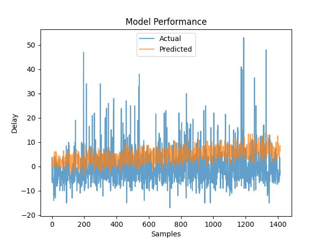
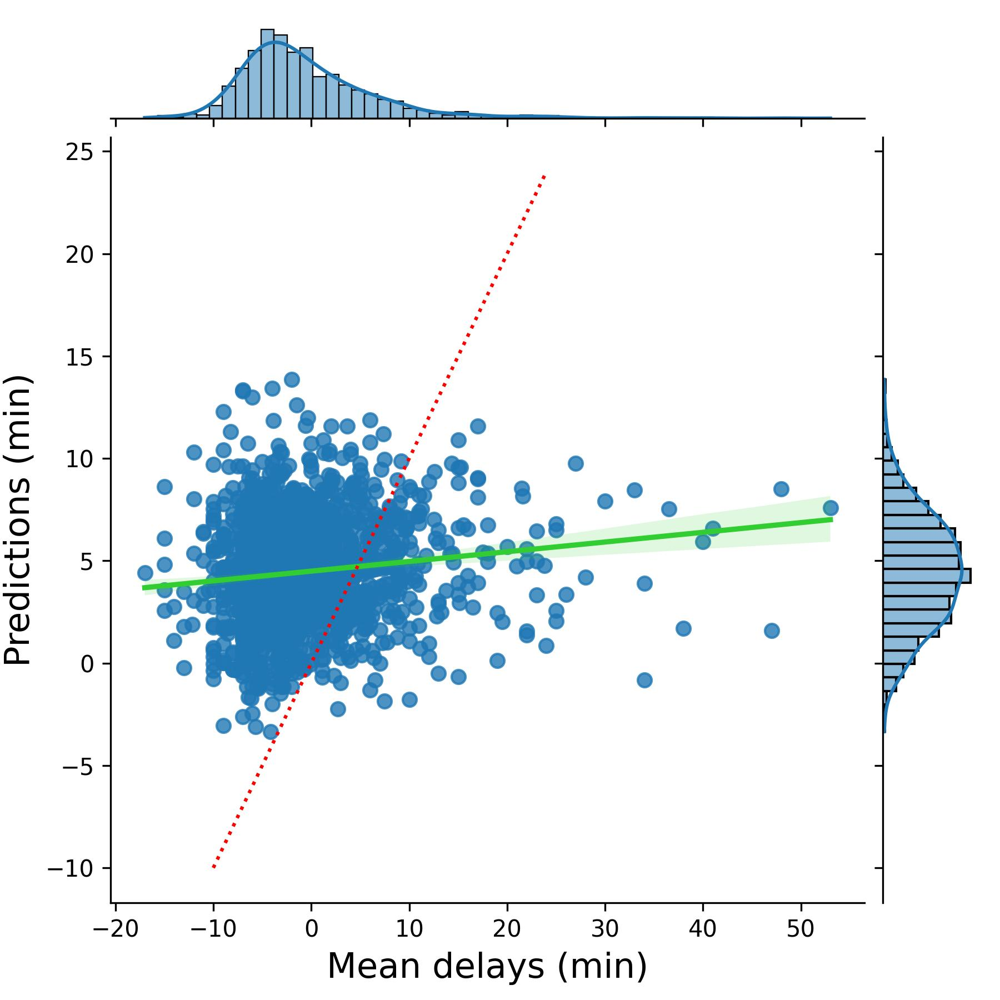

# Flight Delay MLOps Pipeline

## Overview
This project builds an end-to-end machine learning workflow for predicting average departure delay in minutes for flights leaving a selected origin airport. It combines data preparation, DVC-based data versioning, MLflow experiment tracking, a FastAPI prediction service, unit tests, and deployment-oriented assets.

## Academic Context
Completed during my M.S. in Data Analytics at Western Governors University (WGU), then packaged here as a reproducible public portfolio project.

## Project Goal
Create a reproducible pipeline that prepares airline on-time data, trains a delay prediction model, logs experiments, and serves predictions through an API.

## Pipeline Summary
1. Import and format airline on-time performance data
2. Filter the dataset to departures from Atlanta
3. Clean the data by removing missing departures, removing duplicates, and standardizing spacing
4. Train a Ridge regression model using encoded destination airports plus departure and arrival times
5. Track experiments, metrics, parameters, and artifacts in MLflow
6. Expose predictions through a FastAPI endpoint
7. Validate endpoint behavior with pytest

## Stack
- Python
- scikit-learn
- DVC
- MLflow
- FastAPI
- Docker
- GitLab CI/CD
- pytest

## Model
- Problem type: regression
- Algorithm: Ridge regression
- Features: one-hot encoded destination airport, scheduled departure time, scheduled arrival time
- Alpha sweep: 20 values from 0.0 to 3.8
- Logged metrics: mean squared error and average predicted delay

## Results
- Selected Ridge alpha: `3.8`
- Final test MSE: `79.65`
- Final test RMSE: `8.92` minutes
- Mean predicted delay: `4.48` minutes

## Selected Visuals

## API
### Endpoints
- `GET /`
- `GET /predict/delays`

### Example
`/predict/delays?dest_airport=LAX&departure_time=14:30&arrival_time=17:45`

## Testing
The copied test suite covers:
- valid request returns `200`
- invalid airport returns `400`
- invalid time format returns `400`
- missing required parameters returns `422`

## Run and test

From the repository root with Python 3.11, install the dependencies and launch the API.

~~~sh
python -m pip install -r requirements.txt
python -m pytest -q tests
python -m uvicorn deployment_api:app
~~~

Both ASGI entry points use the same trained model and preprocessing artifacts from the src directory. A request can use an IATA code such as LAX or its BTS ID, 12892. The lookup comes from the paired destination fields in the supplied Atlanta flight records. The time fields are local scheduled times in HH:MM format.

To rebuild the cleaned data and retrain the model, run the following from the repository root. This writes the model and airport encodings consumed by the API. The GitLab training job runs both steps before testing the rebuilt service.

~~~sh
python src/Task_2.py
python src/Task_2_MLFlow.py
~~~

## Notebooks
- `notebooks/flight_delay_pipeline.ipynb` — end-to-end data pipeline: imports and formats BTS on-time data, filters to Atlanta departures, cleans missing values and duplicates, trains Ridge regression, and evaluates on the test set
- `notebooks/flight_delay_mlflow_tracking.ipynb` — MLflow experiment tracking run: sweeps 20 alpha values, logs parameters, metrics, and the final model artifact

## Included Files
- `notebooks/flight_delay_pipeline.ipynb`
- `notebooks/flight_delay_mlflow_tracking.ipynb`
- `Dockerfile`
- `.gitlab-ci.yml`
- `deployment_api.py`
- `api_tests.py`
- `src/deployment_api.py`
- `src/airport_encodings.json`
- `src/finalized_model.pkl`
- `tests/test_api.py`
- `data/cleaned_data.csv`
- `data/T_ONTIME_REPORTING.csv`
- `data/*.dvc`
- `.dvc/config`
- `.dvcignore`
- `.gitignore`
- `requirements.txt`
- `assets/model_performance_test.jpg`
- `assets/performance_plot.png`

## Coursework artifacts

The root-level model and encoding files preserve the earlier coursework export. The service loads the matching numeric-ID model and encoding table under src, with an IATA lookup generated during preprocessing. MLflow experiment tracking runs directly from the training script or notebook.

## A separate grocery MLOps design

The [Kronkers case study](docs/kronkers-mlops-design.md) connects inventory decisions to forecast monitoring, release controls, retraining and operating costs.
